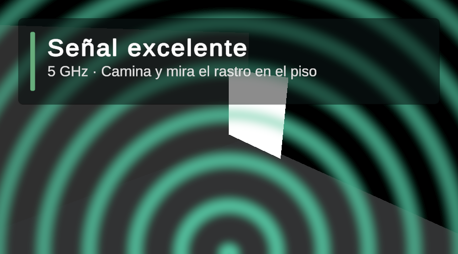

# WifiAR

See your WiFi signal as waves. Open the app, walk around your home and watch the rings change:
many bright teal rings where the signal is strong, a few thin amber or red ones where it is weak.

Android · Unity 6 · AR Foundation / ARCore

> **Status:** working prototype, tested on one phone (Galaxy A56 5G, Android 16). Not on Google Play.
> The interface is in Spanish for now.

| Live waves | Floor field (experimental) |
|---|---|
|  |  |

Both images are from Editor play mode with simulated data, not from a phone.

## What it does

- **Live waves.** A screen overlay driven by the signal strength of the network the phone is
  connected to. It works from the first second, needs no setup and does not depend on AR tracking.
- **Floor field (experimental).** While ARCore tracking is stable, each reading is left on the floor
  and blended into a wave field that spreads from the strongest spot found so far, which in practice
  is the router. It hides itself whenever tracking cannot be trusted.
- **No location permission.** Only `CAMERA` and `ACCESS_WIFI_STATE`. Nothing leaves the device.

## What the device taught me

Measured on a Galaxy A56 5G. These shaped the design more than any plan did.

- **Signal strength is readable without location permission.** Android gates SSID and BSSID behind
  location, but not RSSI, frequency or link speed.
- **Android refreshes RSSI only about every 3 s** (2.7–3.2 s measured). At a slow walk that is one
  sample every 1.5–3 m, so `SignalSampler` ties a reading to the place where it first showed up
  instead of smearing it along the path.
- **The phone roams between bands mid-walk** (5 GHz to 2.4 GHz at the far end of the house). The
  band is stored per sample, and ring spacing reflects it.
- **ARCore can say "tracking" while its pose flies away** at hundreds of metres per second.
  `PoseValidator` rejects poses by step size and windowed speed, not by session state alone.
- **In dim rooms ARCore flips between tracking and initializing several times per second** and never
  settles. An earlier version waited for tracking before showing anything and was unusable at night.
  That is why nothing blocks on AR any more.
- **Per-frame speed is a trap.** Pose updates arrive at camera rate while frame times jitter, so a
  normal 2 cm update landing on a 2 ms frame reads as 10 m/s. There is a regression test for it.
- **ARCore XR Plugin 6.4.2 does not build on Unity 6.4.** The version pinned by Unity's AR Mobile
  template fails in Gradle with a duplicate `com.google.ar.core` namespace; 6.4.3 fixes it.

An honest conclusion from all this: for a signal meter, AR is an extra rather than the core. The live
overlay carries the app; the floor field only appears in good light.

## How it is built

Everything lives in `Assets/_WifiAR/`.

| Area | Type | Role |
|---|---|---|
| `Scripts/Wifi` | `IWifiSignalSource` | Reads the connected network. `AndroidWifiSignalSource` calls `WifiManager` through JNI; `SimulatedWifiSignalSource` fakes a router for the Editor. |
| `Scripts/Sampling` | `SignalSampler` | Decides which readings become map points. |
| | `PoseValidator` | Decides whether the AR pose can be trusted. |
| | `SignalQuality` | dBm to 0..1 strength, level, label and color. |
| `Scripts/Visualization` | `SignalGrid` | Inverse-distance interpolation on a floor grid, with a confidence value so unmeasured areas are never painted as fact. |
| | `WaveFieldRenderer` + `Shaders/WaveField.shader` | The floor field. |
| | `LiveWaveOverlay` + `Shaders/LiveWaves.shader` | The screen overlay. |
| `Scripts/App` | `ScanController` | Wires it together. |
| `Scripts/Diagnostics` | `SignalProbe` | Raw on-screen readings and CSV log, used to take the measurements above. |
| `Editor` | `ProjectSetup` | Applies Android and ARCore settings from a menu. |

Sampling, pose validation and the grid are plain C# with no scene dependencies, which is what the
tests cover.

## Build and run

Requirements: Unity **6000.4.5f1** with Android Build Support, and an
[ARCore-supported](https://developers.google.com/ar/devices) phone on Android 11 or later.

1. Open the project in Unity.
2. Run `Tools > WifiAR > Configure Project` (package id, IL2CPP, ARM64, API 30–36, ARCore required,
   depth optional).
3. `File > Build Profiles`, switch to Android, build and run. The only scene in the build is
   `Assets/_WifiAR/Scenes/Main.unity`.

In the Editor, play mode uses XR Simulation and the simulated WiFi source, so the whole flow runs
without a phone.

`com.unity.ai.assistant` in `Packages/manifest.json` is editor tooling only and can be removed.

## Tests

39 EditMode tests. Run them from `Window > General > Test Runner`, or headless:

```
Unity.exe -batchmode -runTests -testPlatform EditMode -projectPath . -testResults TestResults.xml
```

## Known leftovers

The repository still contains the unused content of Unity's AR Mobile template
(`Assets/MobileARTemplateAssets`, `Assets/Samples`, `Assets/Scenes/SampleScene.unity`). None of it is
in the build.

## Resumen en español

App Android que muestra la señal WiFi como ondas. Al abrirla ya se ven anillos en pantalla según la
intensidad de la red conectada, sin pasos previos. Cuando ARCore logra ubicarse con buena luz, además
deja un rastro de color en el piso que nace del punto de señal más fuerte. No pide permiso de
ubicación ni envía datos. Es un prototipo probado en un solo teléfono.

## License

Code under `Assets/_WifiAR` is released under the [MIT License](LICENSE). Unity template and sample
assets, and the TextMesh Pro resources, remain under Unity's own license terms.
